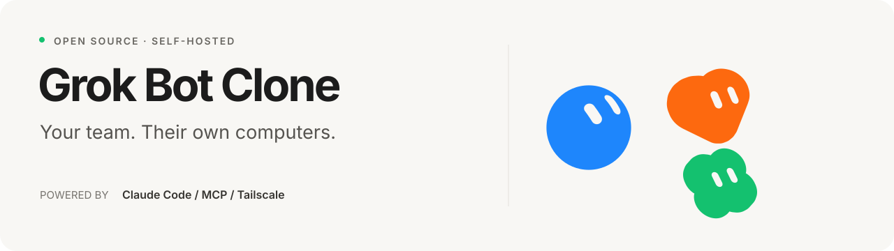

<p align="center">
  
</p>

<p align="center">
  A self-hosted Grok Bot clone with computer use, connected apps, memory, and routines.<br>
  Bots run on the Claude Code CLI with your Claude subscription.
</p>

<p align="center">
  <a href="#quick-start">Quick start</a> ·
  <a href="#what-you-can-do">Features</a> ·
  <a href="docs/ARCHITECTURE.md">Architecture</a> ·
  <a href="#development">Development</a> ·
  <a href="https://github.com/nickvasilescu/grokbot-clone/issues">Issues</a>
</p>

---

Give a Bot a job, connect the apps it needs, and follow its work in chat. Each Bot has a name, a look, its own memory, and a desktop you can watch or take over. Bots can work together and run recurring tasks.

Grok Bot Clone recreates the Grok Bot experience with a runtime you can run and modify yourself. It is a single-user install: there is no sign-in, no xAI account, and no cloud computer service. Everything runs on one machine (usually a small Linux VM) and is reached over Tailscale. Conversations, settings, and agent state live in a local SQLite database.

## What you can do

- **Give every Bot a role.** Set its instructions, appearance, skills, and memories. Make one your primary point of contact. Pick each Bot's model (Default, Fable, Opus, Sonnet or Haiku) and thinking level (Low to Max).
- **Put it to work on a computer.** Each Bot gets its own browser (headless Chromium with a persistent profile, so logins stick). It works from the page's accessibility tree, clicking and typing by element, and uses screenshots when it needs to see. Watch live, take control with your own mouse and keyboard, and find downloads and saved work in the Library.
- **Connect your apps.** Each app is an MCP server: a hosted http/sse URL or a local command. The catalog includes Zapier, Notion, GitHub, Brave Search, Context7, Exa, Stripe, DeepWiki, Hugging Face, Cloudflare Docs, Linear and Sentry, and you can add any other MCP server. Apps use a token or key, or a sign-in (OAuth) in a popup. Read-only actions run automatically; actions that change data pause for approval (Allow once, Always allow, or Deny).
- **Build a team.** Bots message each other, start subagents, and join group chats with @mentions.
- **Keep work moving.** Schedule routines and let your primary Bot check in proactively.
- **Keep context.** Bots retain durable memories and recall them later. Each Bot resumes its own Claude Code session, which handles long-conversation compaction.
- **Dictate.** Push-to-talk dictation in the composer uses your browser's speech recognition (⌘/Ctrl+D).

## Quick start

### 1. Get the project

You need **Node.js 22 or newer** and the [Claude Code CLI](https://claude.com/claude-code), logged in with `claude`.

```bash
git clone https://github.com/nickvasilescu/grokbot-clone.git
cd grokbot-clone
npm ci
cp .env.example .env   # optional; every setting has a default
```

### 2. Start the app

Run the API in one terminal:

```bash
npm run dev -w server
```

Run the frontend in a second terminal:

```bash
npm run dev -w web
```

Open **[localhost:5173](http://localhost:5173)**. The frontend proxies API requests to port `8787`. Your install starts with a primary Bot. Create another Bot, give it a role, and send it a task.

Chat turns use your Claude subscription and count against its usage limits. Bot computers need Chromium or Google Chrome on the host (set `CHROMIUM_PATH` if it isn't in a usual place); without it chat works but computers are unavailable.

### Run a built version

```bash
npm run build
npm start
```

The server listens on `127.0.0.1:8787` and serves the built app. There is no sign-in, so do not expose it to the public internet. To reach it from your own devices, use Tailscale:

```bash
tailscale serve --bg --https=443 http://127.0.0.1:8787
```

## How it works

| Layer | Implementation |
| --- | --- |
| Web app | React, TypeScript, Vite, and Zustand |
| Server | Node.js, Hono, SQLite, and Server-Sent Events |
| Agent runtime | `claude -p --output-format stream-json`, one resumable session per Bot, with Bot tools served over a local MCP endpoint |
| Computers | Headless Chromium per Bot, driven with Playwright over CDP; the viewer is a live screencast over a WebSocket |
| Connected apps | MCP servers (http, sse, or stdio) added to every Bot's Claude Code session |
| Approvals | Claude's `--permission-prompt-tool`, answered from a card in chat |
| Dictation | Browser speech recognition |

The server starts one headless Claude Code process per Bot turn, streams its output into the transcript, and serves the Bot's own tools (memory, routines, tasks, messaging, subagents, groups, questions, computer use) to it over MCP. At most two Claude processes run at once, and a new one starts only when enough memory is free.

For the details, read the [architecture guide](docs/ARCHITECTURE.md). [`STATUS.md`](STATUS.md) lists what is done, what is verified, and what is left, plus the deploy steps.

## Development

```bash
npm run typecheck       # Check the server and frontend
npm run build           # Build both workspaces
```

The main source directories are:

```text
server/src/     API routes, agent runtime, tools, computers, and connected apps
web/src/        Chat, Bot settings, connect-apps, computer viewer, and dictation
web/artwork/    Original design assets used to generate Bot avatars
web/public/     Static UI assets
docs/           Architecture guide
```

### Contributing

Bug reports, improvements, and pull requests are welcome. For a bug, include the steps to reproduce, expected behavior, Node version, and relevant logs with secrets removed. For larger changes, open an [issue](https://github.com/nickvasilescu/grokbot-clone/issues) first to discuss the approach.

Keep changes focused, run the typecheck and build, and describe how you verified the affected flow. Never commit `.env` files, databases, app tokens, or screenshots containing personal information.

## Project status

This is an experimental project and has not undergone a security audit. Bots can run shell commands on the host with passwordless sudo, so use a dedicated machine. Approvals cover connected-app actions that change data; they do not cover everything a Bot can do through its browser or shell.

## License and credits

Project code is available under the [MIT license](LICENSE). Third-party artwork and trademarks retain their owners' rights; see [third-party notices](THIRD_PARTY_NOTICES.md).

Inspired by Grok Bot. Runs on [Claude Code](https://claude.com/claude-code) and the [Model Context Protocol](https://modelcontextprotocol.io). This is an independent project, unaffiliated with xAI, Cursor/Anysphere, or Anthropic.
